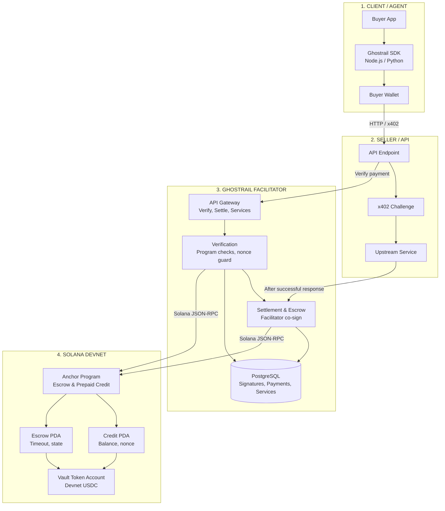
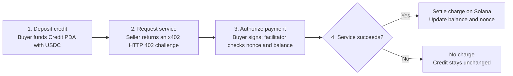
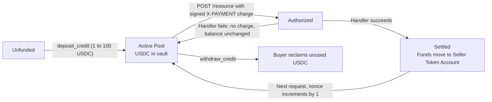

# Ghostrail

**Self-hosted x402 payment facilitator for Solana devnet.**

Ghostrail enables AI agents and apps to pay for APIs using reusable prepaid USDC credit on Solana devnet. Buyers deposit once into a deterministic, non-custodial credit account, then sign a nonce-protected charge for each successful API request. Sellers integrate a standard HTTP 402 challenge/response flow and only charge after delivery succeeds.

> [!NOTE]
> **Devnet deployment.** Ghostrail and its Anchor escrow program are configured and audited for Solana devnet. Registered services are listed by sellers.

---

## Architecture & System Design

Ghostrail coordinates trustless, automated micropayments between autonomous agents (buyers), API services (sellers), and the Solana devnet blockchain.

### System Architecture Diagram

---

### Payment Flow & State Lifecycle

The complete transaction lifecycle proceeds across four deterministic phases:

#### State Transition Lifecycle

---

## Key Components

### On-Chain Program (`escrow/`)

An [Anchor](https://www.anchor-lang.com/) program deployed on Solana devnet with six instructions:

| Instruction       | Description                                                    |
| ----------------- | -------------------------------------------------------------- |
| `lock`            | Lock USDC into a per-buyer escrow PDA with a timeout (60s–1hr) |
| `release`         | Seller confirms delivery → funds transfer to seller            |
| `refund`          | Buyer reclaims funds after timeout expires                     |
| `deposit_credit`  | Fund a reusable buyer↔seller credit account (1–100 USDC)       |
| `charge_credit`   | Deduct from credit with a buyer-signed nonce (per-call charge) |
| `withdraw_credit` | Buyer withdraws unused credit at any time                      |

**Account PDAs:**

- **Escrow:** `["escrow", buyer, escrow_id]` — per-transaction, one-time use
- **Credit:** `["credit", buyer, seller, mint]` — reusable, one per buyer/seller/mint
- **Vault:** `["vault", escrow_or_credit]` — token account holding locked USDC

### Facilitator Backend (`backend/`)

The Next.js server acts as a neutral facilitator:

- **`verify.ts`** — Validates buyer-signed escrow lock transactions: checks instruction shape, allowed programs, compute limits, timeout bounds, escrow funding, fee-payer isolation, and replay prevention.
- **`prepaid.ts`** — Validates prepaid charge authorizations, submits deposits, settles charges after handler success.
- **`settlement.ts`** — Co-signs seller release transactions and submits buyer-signed refunds.
- **`escrow.ts`** — Reads on-chain escrow/credit accounts via Anchor.
- **`services.ts`** — Service registry CRUD with secret-token-protected deletion.
- **`db.ts`** — PostgreSQL persistence: schema auto-migration, payment records, signature dedup, service registry.

### API Routes (`app/api/`)

| Method   | Route                | Purpose                                                       |
| -------- | -------------------- | ------------------------------------------------------------- |
| `POST`   | `/api/payments/verify` | Verify a buyer-signed payment (escrow lock or prepaid charge) |
| `PUT`    | `/api/settlements`   | Submit settlement (release, refund, deposit, or charge)       |
| `GET`    | `/api/payments`      | Query payment by signature, escrow, credit, or list recent    |
| `GET`    | `/api/services`      | List all registered services                                  |
| `POST`   | `/api/services`      | Register a new service                                        |
| `GET`    | `/api/services/[id]` | Get service details + payment requirements                    |
| `DELETE` | `/api/services/[id]` | Delete a service (requires Bearer token)                      |

The legacy `GET`, `POST`, and `PUT /api` endpoints remain available for existing integrations.

### Frontend (`app/`) 

- **Landing page** — Product overview, architecture features, and seller integration example
- **Dashboard** — Payment records and verified, rejected, and volume statistics
- **Services** — Service registration and deletion with a one-time delete token
- **Playground** — Inspect x402 payment challenges and try buyer-signed requests
- **Docs** — Integration guide for the x402 challenge → deposit → charge flow

### Client SDKs (`ghostrail_sdk/`)

Available in **Node.js** and **Python**:

| Operation              | Buyer              | Seller              |
| ---------------------- | ------------------ | ------------------- |
| Call a paid service    | `callService()`    | —                   |
| Deposit USDC credit    | `depositCredit()`  | —                   |
| Withdraw unused credit | `withdrawCredit()` | —                   |
| Check credit balance   | `checkCredit()`    | —                   |
| Register a service     | —                  | `registerService()` |
| Delete a service       | —                  | `deleteService()`   |

---

## Payment Models

### 1. Prepaid Credit (Primary)

The buyer deposits USDC into a reusable credit account bound to one seller wallet. Each API call uses a buyer-signed `charge_credit` instruction with an incrementing on-chain nonce. The charge is only submitted after the seller's handler succeeds, so failed deliveries don't cost anything.

### 2. Per-Request Escrow (Legacy)

The buyer locks USDC into a one-time escrow PDA with a timeout. The seller releases to claim payment; the buyer refunds after timeout. The buyer signs and pays the transaction fee, so their wallet needs devnet SOL.

---

## Security Properties

- **Non-custodial** — USDC is held in Anchor PDAs. The facilitator cannot redirect escrow funds; after timeout, any caller can trigger a refund only to the buyer recorded on-chain.
- **Fail-closed verification** — Every transaction instruction is audited for allowed programs, discriminator shapes, exact mint, seller, amount, account shapes, and compute limits.
- **Replay prevention** — Accepted signatures are indexed in PostgreSQL and checked against Solana signature status.
- **Nonce ordering** — Prepaid charges require the exact next on-chain nonce, preventing double-spend.
- **Fee-payer isolation** — The fee payer is blocked from appearing as an escrow authority.
- **Charge-after-delivery** — Sellers only submit the charge after their handler succeeds.
- **Withdrawable credit** — Buyers can withdraw unused USDC at any time via `withdraw_credit`.
- **Manual escrow refunds** — Buyers can submit a signed refund after the escrow timeout from the Playground. The buyer pays the transaction fee; prepaid credit can be withdrawn at any time.

---

## Quick Start

### Prerequisites

- Node.js 26.x LTS
- PostgreSQL database
- Solana CLI + devnet SOL
- Anchor CLI (to build/deploy the escrow program)

The Playground can submit a buyer-signed refund after its escrow timeout. Buyers need devnet SOL for the refund transaction and, if needed, creation of their USDC token account. Refunds return funds only to the buyer recorded in escrow.

The app uses the Node.js runtime for blockchain and PostgreSQL API handlers. Vercel's standard Next.js build and output settings are sufficient; no custom output directory is required.

## Tech Stack

| Layer      | Tech                                                          |
| ---------- | ------------------------------------------------------------- |
| Frontend   | Next.js 16, React 19, CSS (custom)                            |
| Backend    | Next.js API Routes, TypeScript, `server-only`                 |
| Database   | PostgreSQL (via `pg`)                                         |
| Blockchain | Solana devnet, Anchor, `@solana/web3.js`, `@solana/spl-token` |
| Protocol   | x402 HTTP transport with Ghostrail prepaid Solana scheme      |
| SDKs       | Node.js (ESM), Python                                         |

### x402 integration

Ghostrail uses the official `@x402/core` HTTP codec for payment signatures. The
facilitator decodes `X-PAYMENT` with
`decodePaymentSignatureHeader` before validating the Solana-specific prepaid
payload, rather than treating the header as an application-only base64 format.
The NVIDIA seller also emits the standard `PAYMENT-REQUIRED` header on HTTP
402 responses and `X-PAYMENT-RESPONSE` after settlement.

---
